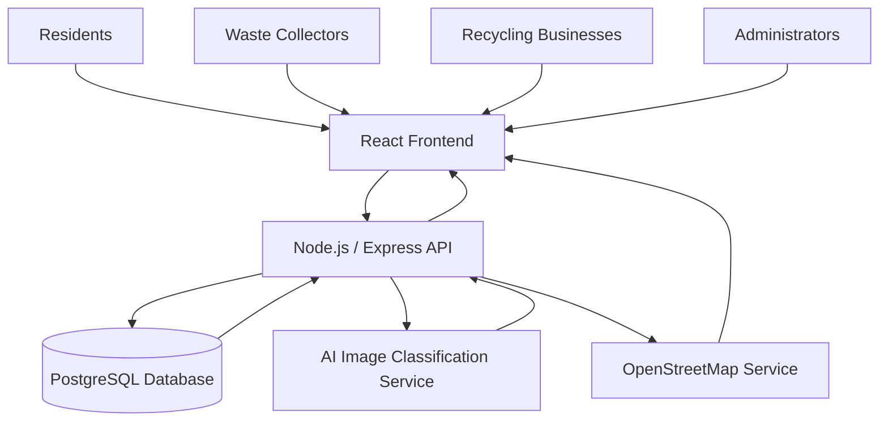

# System Architecture – Plastic2Future AZ

## 1. Overview

Plastic2Future AZ is a web-based platform that connects residents, waste collectors, and recycling businesses.

The system follows a three-layer architecture consisting of a frontend application, backend API, and database. External services provide AI-powered plastic identification and map functionality.

## 2. Technology Stack

| Component | Technology | Responsibility |
|---|---|---|
| Frontend | React.js | User interface and interactions |
| Styling | Tailwind CSS | Responsive interface design |
| Backend | Node.js and Express | API endpoints and business logic |
| Database | PostgreSQL | Store users, collection points, records, and listings |
| AI Service | Image classification API | Identify likely plastic types from uploaded images |
| Map Service | OpenStreetMap | Display plastic collection locations |
| Deployment | Vercel and Render | Host frontend and backend |

## 3. High-Level System Diagram

## 4. Main System Components

### Frontend
- Displays the platform dashboard.
- Provides plastic image upload functionality.
- Displays collection points on a map.
- Allows users to record collected plastic.
- Displays marketplace listings and environmental statistics.

### Backend API
- Processes frontend requests.
- Validates submitted information.
- Manages collection records and marketplace listings.
- Communicates with the AI identification service.
- Retrieves and updates database information.

### Database
Stores:
- User and collector profiles.
- Plastic collection points.
- Plastic collection records.
- Marketplace listings.

### AI Identification Service
- Receives uploaded plastic images.
- Analyzes the images.
- Returns a predicted plastic category.
- Sends identification results to the frontend through the backend.

### Map Service
- Displays collection point locations.
- Provides geographical information.
- Helps users locate recycling facilities.

## 5. Main Data Flow

1. A user opens the Plastic2Future AZ web application.
2. The frontend sends requests to the backend API.
3. The backend retrieves or updates information in PostgreSQL.
4. If a user uploads an image, the backend sends it to the AI identification service.
5. The AI service returns a predicted plastic category.
6. The backend processes the result and returns it to the frontend.
7. The frontend displays the result, collection information, or environmental statistics.

## 6. Deployment Strategy

- Frontend: Vercel.
- Backend: Render.
- Database: Supabase PostgreSQL.
- AI service: External image classification API.

## 7. Architecture Constraints

- The initial architecture will prioritize simplicity and maintainability.
- The application will use REST API endpoints.
- Uploaded images will have file size and format restrictions.
- AI identification will be treated as an estimated result.
- The MVP will initially support a limited number of users and collection points.