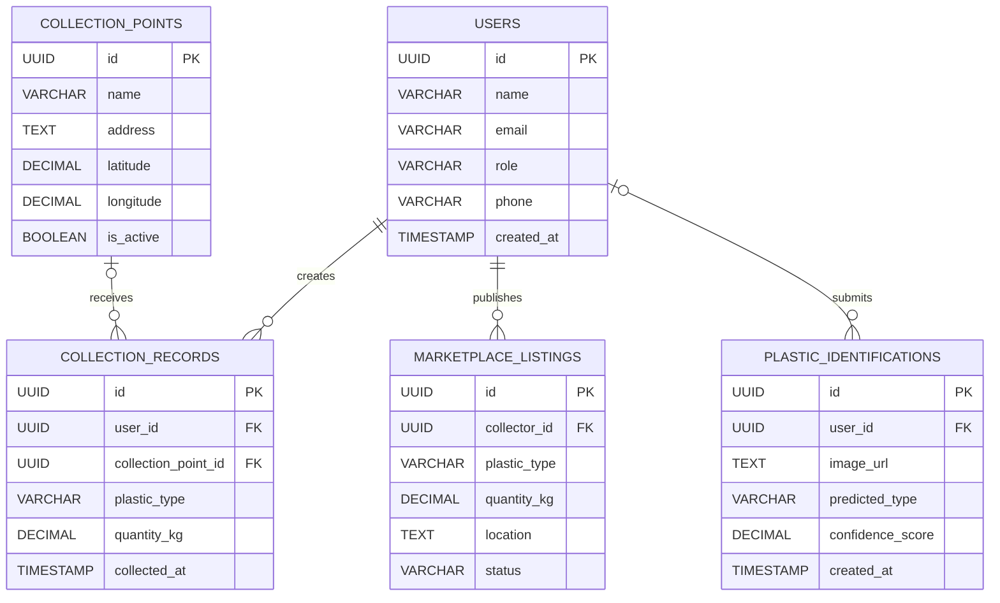

# Data Model – Plastic2Future AZ

## 1. Overview

Plastic2Future AZ uses a relational PostgreSQL database to store user information, plastic collection activities, recycling locations, marketplace listings, and AI identification results.

The database consists of five primary entities.

## 2. Database Entities

### Entity 1 – Users

Stores information about residents, waste collectors, recycling businesses, and administrators.

| Field | Data Type | Description |
|---|---|---|
| id | UUID | Primary key |
| name | VARCHAR(100) | User's full name |
| email | VARCHAR(150) | Email address |
| role | VARCHAR(30) | User role |
| phone | VARCHAR(20) | Optional contact number |
| created_at | TIMESTAMP | Account creation date |

Possible roles:
- resident
- collector
- recycling_business
- administrator

### Entity 2 – Collection Points

Stores information about plastic recycling and collection locations.

| Field | Data Type | Description |
|---|---|---|
| id | UUID | Primary key |
| name | VARCHAR(150) | Collection point name |
| address | TEXT | Physical address |
| latitude | DECIMAL(10,7) | Geographic latitude |
| longitude | DECIMAL(10,7) | Geographic longitude |
| accepted_plastic_types | TEXT | Accepted plastic categories |
| is_active | BOOLEAN | Whether the location is active |
| created_at | TIMESTAMP | Record creation date |

### Entity 3 – Collection Records

Tracks the amount and type of plastic collected by users.

| Field | Data Type | Description |
|---|---|---|
| id | UUID | Primary key |
| user_id | UUID | Foreign key referencing Users |
| collection_point_id | UUID | Optional foreign key referencing Collection Points |
| plastic_type | VARCHAR(50) | Type of collected plastic |
| quantity_kg | DECIMAL(10,2) | Amount collected in kilograms |
| collected_at | TIMESTAMP | Collection date |
| notes | TEXT | Optional additional information |

### Entity 4 – Marketplace Listings

Stores recyclable plastic materials offered by waste collectors.

| Field | Data Type | Description |
|---|---|---|
| id | UUID | Primary key |
| collector_id | UUID | Foreign key referencing Users |
| plastic_type | VARCHAR(50) | Plastic material category |
| quantity_kg | DECIMAL(10,2) | Available quantity |
| location | TEXT | Material location |
| description | TEXT | Listing details |
| status | VARCHAR(30) | Listing availability |
| created_at | TIMESTAMP | Listing creation date |

Possible statuses:
- available
- reserved
- completed

### Entity 5 – Plastic Identification Results

Stores results returned by the AI plastic identification service.

| Field | Data Type | Description |
|---|---|---|
| id | UUID | Primary key |
| user_id | UUID | Optional foreign key referencing Users |
| image_url | TEXT | Uploaded image location |
| predicted_type | VARCHAR(50) | Predicted plastic category |
| confidence_score | DECIMAL(5,4) | AI confidence score |
| created_at | TIMESTAMP | Identification date |

## 3. Entity Relationships

- One user can create multiple collection records.
- One collection point can be associated with multiple collection records.
- One user acting as a collector can create multiple marketplace listings.
- One user can submit multiple plastic identification requests.
- Each collection record belongs to one user.
- Each marketplace listing belongs to one collector.

## 4. Relationship Diagram

## 5. Database Constraints

- Every entity must have a unique primary key.
- Email addresses must be unique when user accounts are enabled.
- Collection quantities must be greater than zero.
- Confidence scores must be between 0 and 1.
- Marketplace listing quantities must be greater than zero.
- Foreign keys must reference existing records.
- Required fields must not contain NULL values.

## 6. Future Improvements

- Add notifications for new marketplace listings.
- Introduce recycling transaction records.
- Add detailed environmental impact calculations.
- Support multiple image uploads for plastic identification.
- Add geographical indexing for faster collection point searches.

## 7. Summary

The proposed data model provides a simple relational structure for the Plastic2Future AZ MVP. It supports the platform's main functionality while allowing additional features and entities to be introduced as the application grows.